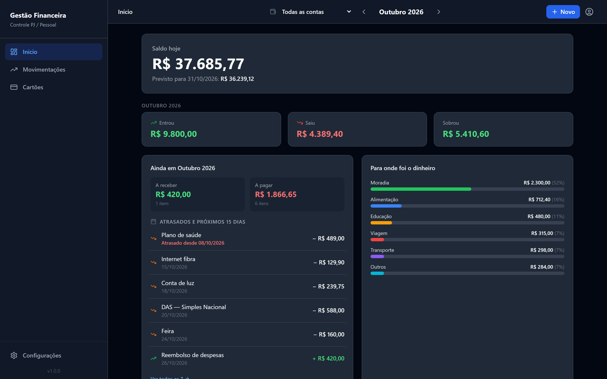
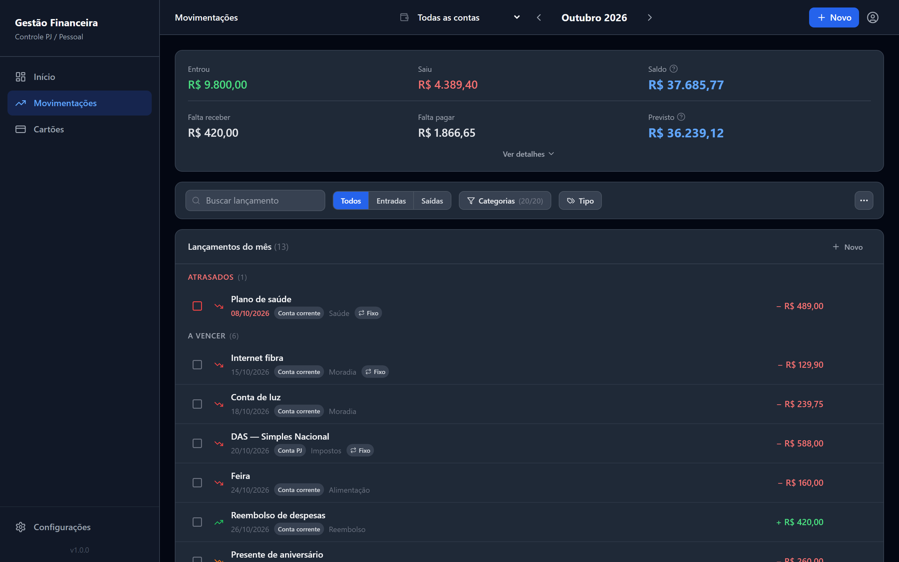
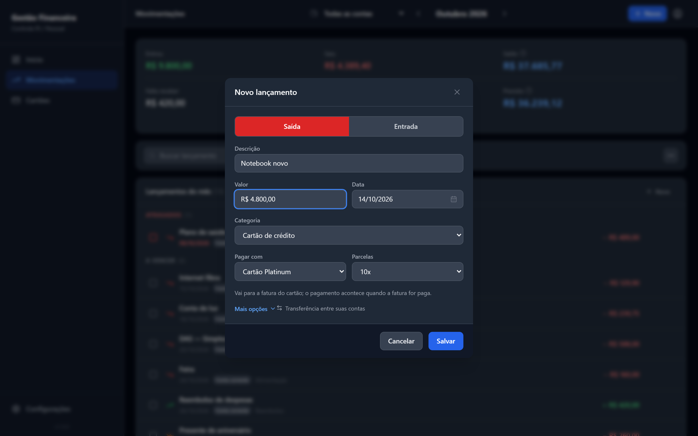
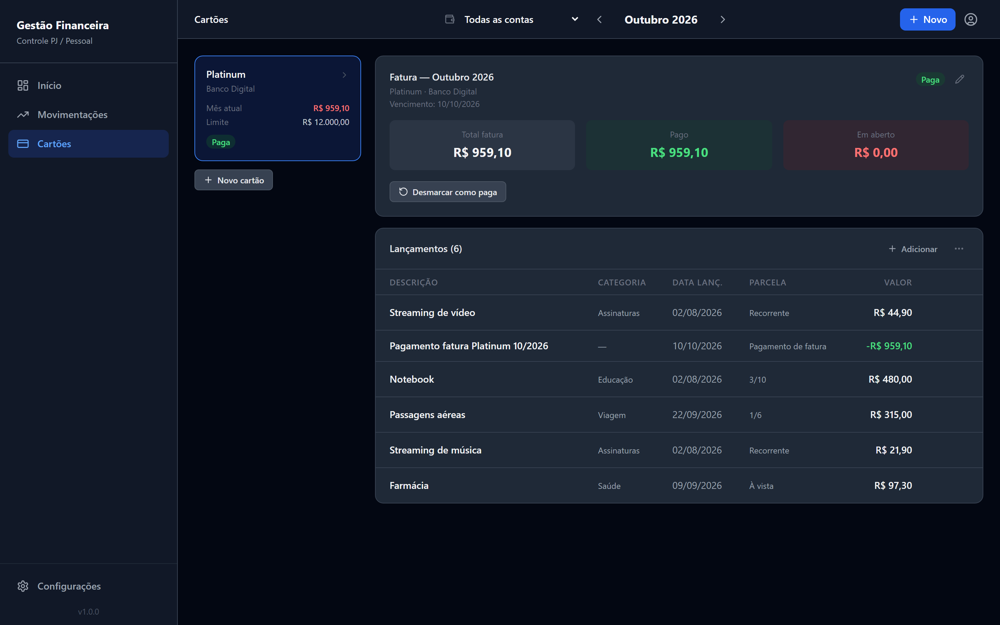
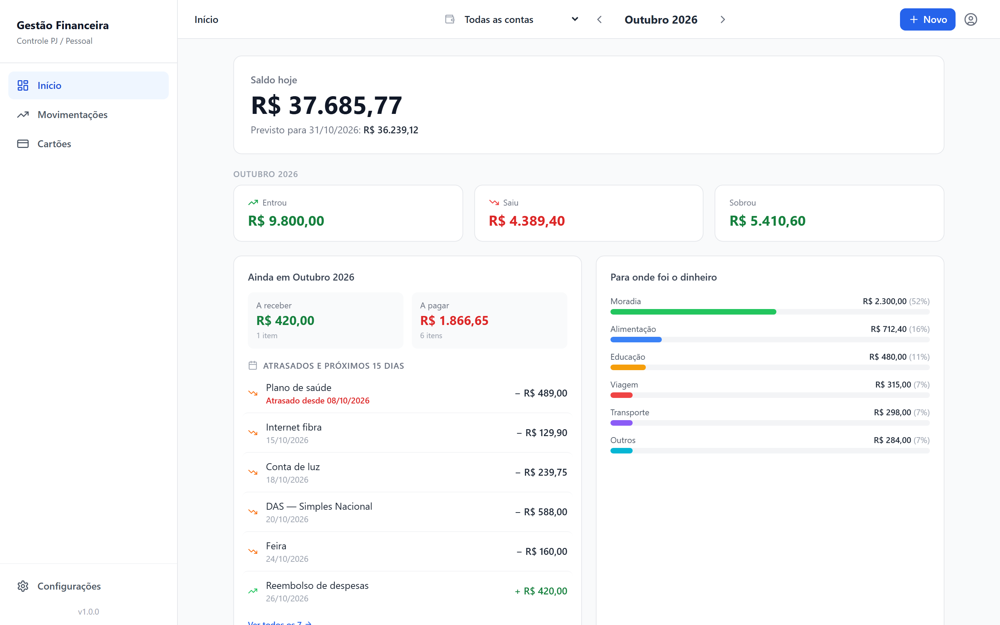
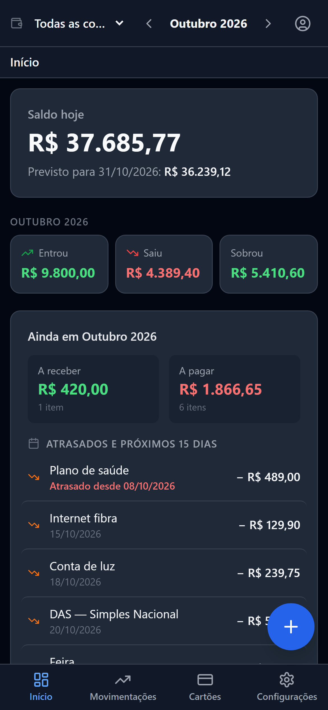
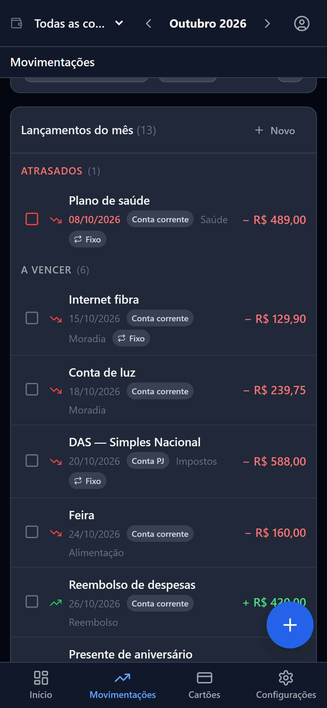

# Gestão Financeira

**Controle financeiro pessoal e PJ pensado para quem nunca usou um sistema financeiro** — abre e mostra em segundos quanto você tem, quanto entrou, quanto saiu e o que ainda vai pagar ou receber, sem esconder os recursos avançados de quem precisa deles.



> Os dados de todas as imagens são **fictícios**, gerados por `npm run seed:demo` (ver [Dados de demonstração](#dados-de-demonstração)).

## O que dá para fazer

- **Início** — saldo de hoje e previsto para o fim do mês, Entrou · Saiu · Sobrou, o que está **atrasado e vence nos próximos 15 dias** e para onde foi o dinheiro. Análise completa (evolução mensal, categorias, saldo por conta, relatório para impressão) fica a um clique.
- **Movimentações** — entradas, saídas, faturas e transferências numa **lista única** agrupada em *Atrasados → A vencer → Concluídos*, com busca, filtros e uma caixa para marcar como pago.
- **"+ Novo" em qualquer tela** (ou tecla `N`) — um formulário só: Saída ou Entrada, valor, data, categoria. Repetição mensal, gasto fora do comum, conta e **compra parcelada no cartão** ficam em "Mais opções".
- **Várias contas** (pessoal, PJ, reserva…) com seletor **"Todas as contas"**, transferências entre contas e **reserva automática** (um % de cada entrada vai sozinho para outra conta).
- **Cartões de crédito** — fatura por mês, parcelamentos, assinaturas, importação de fatura OFX; cada cartão pertence à conta que paga a fatura.
- **Seus dados** — backup completo, exportação CSV, importação de extrato bancário (CSV/OFX).
- **Onboarding com IA** — um assistente conversa com o usuário novo e propõe contas, receitas, despesas e cartões num rascunho; nada é criado sem revisão e confirmação.
- **pt · en · es**, tema claro e escuro, pensado também para o celular.

## Galeria

| | |
|---|---|
|  |  |
| **Movimentações** — lista única agrupada por situação | **Novo lançamento** — Saída/Entrada e "Mais opções" |
|  |  |
| **Cartões** — fatura, parcelas e assinaturas | **Início** no tema claro |

<p align="center">
  
  &nbsp;&nbsp;
  
</p>

## Decisões de produto e engenharia que valem destacar

- **Simplicidade sem perder recurso** — uma interface só, com *divulgação progressiva*: transferências, seletor de conta, reserva automática e menu de Cartões só aparecem quando os dados do usuário os tornam relevantes. O plano completo, com as decisões e o andamento entrega a entrega, está em [`docs/plano-simplificacao-ux.md`](docs/plano-simplificacao-ux.md).
- **Uma regra de resumo para o app inteiro** — transferência entre suas contas não é ganho nem gasto; Início, Movimentações e Relatório usam a mesma função (`frontend/src/utils/month-summary.ts`), coberta por testes. Detalhes em [`docs/domain-logic.md`](docs/domain-logic.md).
- **Dinheiro em centavos inteiros** do banco à tela, sem ponto flutuante.
- **Transferências atômicas** (par de lançamentos ligados, em transação MongoDB) e **migrações idempotentes** que rodam no boot do servidor.
- **i18n com rede de segurança** — um teste falha se algum código de erro do backend ficar sem tradução ou se pt/en/es divergirem.
- **IA com limites claros** — a IA não escreve dados financeiros diretamente: propõe num rascunho que o usuário revisa ([ADR 0003](docs/adr/0003-ai-tools-cannot-write-financial-data.md), [ADR 0004](docs/adr/0004-onboarding-draft-confirmation.md)).
- **Multi-tenant** com login Google (JWT em cookie httpOnly) e proxy same-origin no Cloudflare Pages para o cookie funcionar no Safari/iOS.

## Stack

| Camada | Tecnologias |
|---|---|
| Frontend | React 18, TypeScript, Vite, Tailwind CSS, React Router, TanStack Query, i18next |
| Backend | Node.js, TypeScript, Express, Zod, MongoDB Atlas (driver nativo) |
| IA | Anthropic ou OpenAI atrás de uma abstração de provedor própria ([`ai-platform.md`](docs/architecture/ai-platform.md)) |
| Testes | Vitest + Testing Library (≈100 testes no frontend, ≈280 no backend) |
| Deploy | Cloudflare Pages (frontend + proxy `/api`) e Render (backend) |

## Rodando localmente

Dois pacotes independentes (não é monorepo), cada um com seu `package.json`. Requer Node.js 18+ e uma base MongoDB.

```bash
cd backend && npm install && cp .env.example .env    # preencha MONGODB_URI, JWT_SECRET, GOOGLE_CLIENT_ID
cd frontend && npm install && cp .env.example .env
```

Em dois terminais:

```bash
cd backend && npm run dev     # API em http://localhost:3100
cd frontend && npm run dev    # app em http://localhost:3101
```

### Dados de demonstração

Para ver o app cheio sem usar dados reais, aponte o backend para um banco **separado** (o nome precisa conter `demo`), faça login uma vez e rode:

```bash
cd backend
MONGODB_DB_NAME=gestao_financeira_demo npm run seed:demo
```

O script apaga e recria, só nesse banco, três meses de movimentação fictícia: contas pessoal, PJ e reserva (com reserva automática), um cartão com parcelas e assinaturas, contas fixas, um gasto fora do comum, pró-labore entre contas, itens a vencer e um atrasado. Ele se recusa a rodar em qualquer banco sem `demo` no nome.

### Variáveis de ambiente

**`backend/.env`** (veja `backend/.env.example`):

| Variável | Default | Descrição |
|---|---|---|
| `PORT` | `3100` | Porta do servidor Express |
| `CORS_ORIGIN` | `http://localhost:3101` | Origem permitida para CORS |
| `MONGODB_URI` | — | String de conexão do MongoDB |
| `MONGODB_DB_NAME` | `gestao_financeira` | Nome do banco |
| `JWT_SECRET` | — | Segredo para assinar o cookie de sessão |
| `GOOGLE_CLIENT_ID` | — | OAuth Client ID do Google |
| `PROXY_SHARED_SECRET` | — | Segredo compartilhado com o proxy `/api` do Cloudflare (mesmo valor nos dois) para o backend confiar no IP real do cliente |
| `TRUST_PROXY_HOPS` | `1` | Proxies confiáveis à frente do Express (load balancer do Render) |
| `COOKIE_SAME_SITE` | `lax` | `SameSite` do cookie de sessão. Só use `none` em deploy cross-site sem o proxy `/api` |
| `AI_PROVIDER` | `fake` | `fake` (determinístico, sem rede), `anthropic` ou `openai` |
| `AI_API_KEY` | — | Chave do provedor ativo — nunca exposta ao frontend |
| `AI_MODEL` | — | Modelo do provedor ativo (obrigatório junto com `AI_API_KEY`) |

**`frontend/.env`**: `VITE_API_URL` (default `http://localhost:3100`; em produção no Cloudflare Pages, `/api`), `VITE_LEGAL_CONTROLLER_NAME` e `VITE_LEGAL_CONTACT_EMAIL` (responsável pelos dados e contato de privacidade, exibidos na Política de Privacidade e nos Termos de Uso — obrigatórios em produção).

**Cloudflare Pages** (variável do projeto, usada por `frontend/functions/api/[[path]].ts`): `API_ORIGIN` = URL pública do backend e `PROXY_SHARED_SECRET` = o mesmo valor do backend. Detalhes em [`stack-template-and-deploy.md`](docs/architecture/stack-template-and-deploy.md#8-problema-conhecido-cookie-de-sessão-bloqueado-em-navegadores-mobile).

### Testes e build

```bash
cd backend && npm run typecheck && npm test
cd frontend && npm run build && npm test     # build inclui tsc
```

## Documentação

- [`docs/plano-simplificacao-ux.md`](docs/plano-simplificacao-ux.md) — plano de simplificação da UX: decisões, entregas e notas de implementação
- [`docs/domain-logic.md`](docs/domain-logic.md) — fatura de cartão, lançamentos fixos e regra do resumo do mês
- [`docs/api.md`](docs/api.md) — endpoints do backend
- [`docs/architecture/`](docs/architecture/) — plataforma de IA, onboarding, tool calling, segurança, deploy
- [`docs/adr/`](docs/adr/) — Architecture Decision Records
- [`docs/backlog.md`](docs/backlog.md) — ideias para as próximas versões
- [`CHANGELOG.md`](CHANGELOG.md) — histórico de mudanças

## Estrutura

```
backend/src/
  modules/        # um módulo por domínio: accounts, cash-flow, credit-cards, transfers, dashboard, onboarding, ai, ...
  shared/         # persistência (MongoStore), erros, middlewares, migrações de boot, utils
  scripts/        # seed, seed:demo, migrações avulsas
  container.ts    # wiring de repositórios, serviços e controllers
frontend/src/
  pages/          # Início (Dashboard), Movimentações (CashFlow), Cartões, Configurações, Onboarding, Relatório
  components/     # layout, formulário único de lançamento, UI reutilizável
  contexts/       # conta, mês, tema, idioma, diálogos, toasts
  locales/        # pt, en, es
docs/             # plano de UX, lógica de domínio, API, arquitetura, ADRs, prints
```
